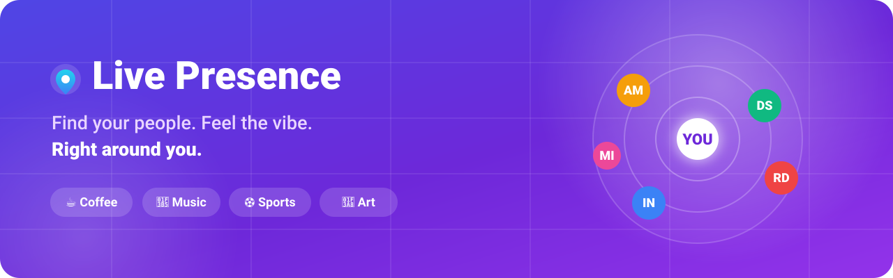
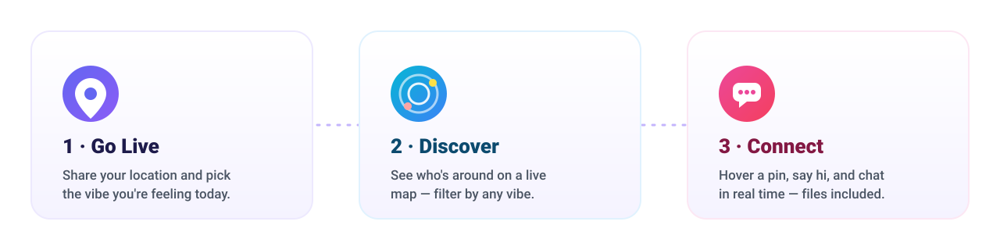
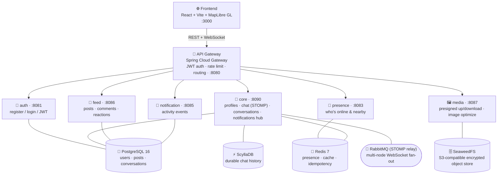

<p align="center">
  
</p>

<h1 align="center">Live Presence</h1>

<p align="center">
  <strong>A social app that connects people with the same vibe — right around them.</strong><br/>
  Go live, see who's nearby on a beautiful map, filter by the vibe you're after, and start chatting instantly.
</p>

<p align="center">
  
  
  
  
  
  
  
</p>

---

## 💡 The idea

Most social apps show you people you already know, or strangers anywhere on earth. **Live Presence flips that.**

It answers one question: **"Who near me is into the same thing right now?"**

Pick a **vibe** — coffee, music, sports, art, fitness, gaming, whatever you're feeling — and the app surfaces people sharing that vibe within your chosen radius, live on a map. No vibe selected? You'll simply see everyone online around you. It's Instagram's feed energy + a real-time "who's around" map + WhatsApp-grade chat, all built around **proximity and mood**.

---

## 🧭 How it works

<p align="center">
  
</p>

1. **Go Live** — share your location and set the vibe you're feeling.
2. **Discover** — see who's online around you on a live vector map, and filter by any vibe within a radius you control (up to ~20 km).
3. **Connect** — hover a pin to see who it is, open a chat, and talk in real time — text, images, and documents included.

---

## ✨ Features

| | Feature | What it does |
|---|---|---|
| 🗺️ | **Live vibe map** | Interactive MapLibre GL vector map with animated markers for everyone online nearby. Hover a marker to see the person and jump straight into **Chat** or **Profile**. |
| 🎚️ | **Vibe filter + radius** | One tap filters the map (and feed) to a single vibe. A slider controls your discovery radius. Nothing selected = everyone online around you. |
| 📰 | **Proximity feed** | An Instagram-style feed of posts from your area, filterable by vibe, with likes, reactions, comments, and image posts. Author avatars show on every post and comment. |
| 💬 | **Real-time chat** | WhatsApp-style 1:1 chat over WebSocket (STOMP). Full history loads every time you reopen a conversation. Send **images and documents up to 10 MB**. |
| 🔔 | **Presence & badges** | Fast online/offline presence. Facebook-style unread **Messages** and **Notifications** badges that reflect activity received while you were away. |
| 🖼️ | **Profiles & avatars** | Upload a profile photo straight from your device. It appears everywhere — map pins, posts, comments, and chat. |
| 🔐 | **Secure media** | Files upload directly to encrypted object storage via presigned URLs, with server-side image optimization (display + thumbnail variants) and AES-256 encryption at rest. |

---

## 🏗️ Architecture

Live Presence is a **microservices** system behind a single API gateway. Each service owns its data and scales independently.



### Why these pieces

| Concern | Choice | Why |
|---|---|---|
| **Maps** | MapLibre GL (OpenFreeMap / MapTiler) | Smooth, stylable **vector** maps with no per-tile cost; markers animate and stay crisp at any zoom. |
| **Realtime chat** | WebSocket + STOMP, RabbitMQ relay | Push delivery with a broker relay so messages fan out across multiple backend nodes. |
| **Durable messages** | ScyllaDB | Cassandra-compatible, write-optimized store so chat history survives restarts and scales horizontally. |
| **Presence** | Redis | Sub-second online/offline with TTL heartbeats and geospatial lookups. |
| **Proximity feed** | PostgreSQL (bounding-box + Haversine) | Index-friendly geo queries with cursor pagination. |
| **Media** | SeaweedFS (S3 API) + presigned URLs | Bytes go **browser → storage directly**, encrypted at rest; app servers stay off the hot path. |

### Tech stack

| Layer | Technology |
|---|---|
| **Frontend** | React 18 · Vite 5 · MapLibre GL · STOMP/SockJS WebSocket |
| **Backend** | Java 21 · Spring Boot 3.3 · Spring Cloud Gateway · Spring Security (JWT) |
| **Data** | PostgreSQL 16 · Redis 7 · ScyllaDB · RabbitMQ 3.13 · SeaweedFS |
| **Platform** | Docker Compose · multi-service monorepo |

---

## 📁 Repository layout

```
live-presence/
├── assets/                     # README artwork (SVG)
├── services/
│   ├── auth/                   # Registration, login, JWT issue/refresh      (:8081)
│   ├── core/                   # Profiles, chat (WebSocket/STOMP),
│   │                           #   conversations, notifications hub           (:8090)
│   ├── presence/               # Online/nearby geospatial tracking (Redis)   (:8083)
│   ├── feed/                   # Location-based posts, comments, reactions    (:8086)
│   ├── notification/           # Activity notifications                       (:8085)
│   ├── media/                  # Presigned upload/download, image optimize    (:8087)
│   ├── gateway/                # Spring Cloud Gateway (single entry point)    (:8080)
│   └── frontend/               # React + Vite SPA                             (:3000)
│       └── src/
│           ├── pages/          # Live (map + feed + chat hub), Login, ProfileEdit
│           └── components/     # MapView, PostFeed, ChatWindow, PostComposer
├── infrastructure/             # RabbitMQ / SeaweedFS local config
├── scripts/                    # Seed + helper scripts
└── docker-compose.yml          # Full local stack
```

---

## 🚀 Quick start

> **Prerequisites:** Docker & Docker Compose. (Java/Node are only needed if you run a service outside Docker.)

```bash
# 1. Bring up the entire stack (databases, services, gateway, frontend)
docker compose up -d --build

# 2. (Optional) seed demo data — posts, comments, and users around Delhi
bash scripts/seed_dummy_data.sh

# 3. (Optional) keep demo users "online" on the map with live heartbeats
bash scripts/seed_presence.sh
```

**Open the app:**

| Service | URL |
|---|---|
| 🌐 Frontend | http://localhost:3000 |
| 🚪 API Gateway | http://localhost:8080 |
| 🩺 Gateway health | http://localhost:8080/actuator/health |

**Demo logins** (all password `demo123`): `demo@live.dev`, `aarav@live.dev`, `diya@live.dev`, `kabir@live.dev`, `ananya@live.dev` …

> 💡 **Prettier maps (optional):** set `MAPTILER_KEY` in your environment before `docker compose up` to use premium MapTiler vector styles. Without a key, the map falls back to the free, no-key OpenFreeMap "Liberty" style.

---

## 🔌 Key APIs

All `/api/**` routes (except `/api/auth/**` and `/api/media/public/**`) require a JWT: `Authorization: Bearer <token>`.

**Discovery & feed**
```http
GET  /api/presence/nearby?lat={}&lon={}&radiusKm={}&limit={}   # who's online around you
POST /api/presence/heartbeat                                   # go live / stay online
GET  /api/posts/feed?lat={}&lon={}&radiusKm={}&interest={}     # proximity feed (vibe-filterable)
POST /api/posts                                                # create a post
POST /api/posts/{id}/comments                                  # comment
```

**Messaging**
```http
POST /api/conversations                      # create/get a 1:1 conversation {targetUserId}
GET  /api/conversations                      # list conversations (+ unread counts)
GET  /api/conversations/{id}/messages        # history (cursor pagination via ?before=)
POST /api/conversations/{id}/read            # mark read
```

**Media (direct, encrypted)**
```http
POST /api/media/presign-upload               # get a presigned PUT URL
POST /api/media/finalize                     # optimize image into display + thumbnail
POST /api/media/download-url                 # short-lived presigned GET URL
GET  /api/media/public/{key}                 # stable, cacheable URL (avatars)
```

**Realtime (WebSocket / STOMP over SockJS at `/ws`)**

CONNECT must carry `Authorization: Bearer <token>`. Destinations use **dots, not slashes** (the broker relay rejects slashes in topic names):

```
SUBSCRIBE  /topic/chat.{conversationId}     # live chat stream
SUBSCRIBE  /topic/feed.new-post             # new posts in your area
SUBSCRIBE  /user/queue/messages             # incoming message signals
SUBSCRIBE  /user/queue/notifications        # bell notifications
SEND       /app/chat.send/{conversationId}  # send a message (text / image / document)
```

---

## 🗺️ Roadmap

- [x] Vector live map with hover-to-chat markers
- [x] Direct, encrypted media uploads (images + documents, 10 MB)
- [x] Durable chat history on ScyllaDB
- [x] Multi-node realtime via RabbitMQ STOMP relay
- [x] Device avatar upload, shown across map, feed, posts & chat
- [ ] Feed at hyperscale (geohash cache + Kafka fan-out)
- [ ] Group vibes / rooms
- [ ] Push notifications & native mobile clients

---

## 📚 More docs

- [QUICKSTART.md](./QUICKSTART.md) — essential commands
- [DEVELOPMENT.md](./DEVELOPMENT.md) — dev environment setup
- [LOCAL_DEVELOPMENT.md](./LOCAL_DEVELOPMENT.md) — running locally
- [DATABASE.md](./DATABASE.md) · [DATABASE_COMMANDS.md](./DATABASE_COMMANDS.md) — data stores
- [DEPLOYMENT.md](./DEPLOYMENT.md) — deployment notes

---

<p align="center"><sub>Built with ☕, 🎵, and a strong sense of vibe. • Live Presence</sub></p>
